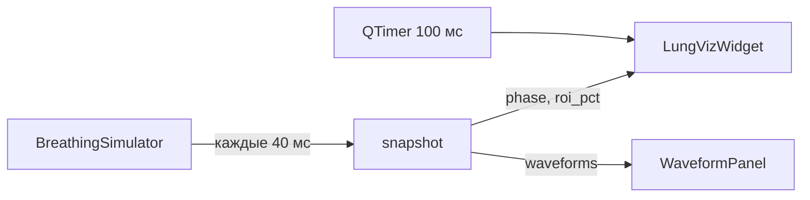

# Визуализация дыхательного цикла

Документ описывает, как в прототипе монитора ЭИТ отображается дыхание на главном экране (виджет `LungVizWidget`), какие данные управляют анимацией и как устроена **уникальная цветовая гамма** лёгочной карты.

---

## Назначение

В левой колонке главного экрана показывается **поперечное сечение грудной клетки** — схематичная «картина дыхания» в реальном времени. Это не реконструкция ЭИТ-изображения, а наглядный индикатор фазы цикла и региональной вентиляции, синхронизированный с мок-данными симулятора `BreathingSimulator`.

Цель визуализации — дать оператору мгновенное понимание:

- на какой фазе цикла находится пациент (выдох ↔ вдох);
- как «наполнены» правое и левое лёгкое;
- где расположены восемь зон интереса (ROI_1 … ROI_8);
- как ориентировано сечение относительно кровати (перед/зад).

---

## Поток данных



1. **Симулятор** (`app/mock_data.py`) на частоте 25 Гц генирует плетизмограмму в стиле LuMon: асимметричный профиль эупноэ (15 вд/мин), 8 региональных каналов с разными амплитудами и малыми фазовыми сдвигами.
2. Из текущего момента времени формируется снимок `BreathingSnapshot`:
   - `phase` — нормализованная амплитуда глобального LI в текущей точке цикла (0 ≈ конец выдоха, 1 ≈ пик вдоха);
   - `roi_pct` — восемь значений региональной вентиляции в процентах (ROI_1–4 — правое лёгкое, ROI_5–8 — левое).
3. **Главный экран** (`MainScreen`) каждые 100 мс вызывает `lung_viz.update_state(snap.phase, snap.roi_pct)`, после чего виджет перерисовывается через `QPainter`.

---

## Состав сцены

Виджет рисует следующие элементы (сверху вниз):

| Элемент | Поведение | Цвет / стиль |
|---------|-----------|--------------|
| Заголовок «Дыхательный цикл» | Статичный, локализуемый | `#8b949e` (`text_dim`) |
| Метки **R** / **L** | Обозначают правую и левую половины | `#f44336` / `#4caf50` — фирменные цвета секций аэрации |
| Контур **торакса** | Эллипс, задаёт границу грудной клетки | Заливка `#0a1628`, обводка `#2d4a70` |
| **Правое** и **левое лёгкое** | Два эллипса; размер и оттенок меняются во времени | См. раздел «Уникальная гамма» |
| **16 электродов** | Точки по окружности торакса | `#40c4ff` (голубой акцент) |
| Подписи **ROI_1 … ROI_8** | Слева — правое лёгкое, справа — левое | `#8b949e` |
| Маркер **позвоночника** | Символ ▼ у нижней границы сечения | `#4d5a6a` |
| **Поверхность кровати** | Горизонтальная полоса внизу (задняя ориентация) | `#3d5a72` |

Фон панели — `#111827` (`bg_panel`), в общей тёмной медицинской теме интерфейса.

---

## Механика анимации

Анимация строится на двух независимых, но согласованных параметрах: **фазе дыхания** и **уровне вентиляции** по каждой стороне.

### 1. Изменение объёма (фаза)

При вдохе оба лёгких плавно увеличиваются. Масштаб эллипсов:

```
scale = 1.0 + 0.12 × phase
```

То есть на пике вдоха лёгкие на **12 %** больше, чем в конце выдоха. Правое лёгкое чуть шире левого (≈ 52 % / 48 % вентиляции в мок-данных), что отражено в базовых размерах эллипсов.

### 2. Цветовая насыщенность (вентиляция + фаза)

Для каждой стороны усредняются четыре ROI:

- правое: `mean(roi_pct[0:4]) / 100` → диапазон 0…1;
- левое: `mean(roi_pct[4:8]) / 100`.

Итоговый уровень заливки:

```
lvl = clamp(vent + 0.3 × phase, 0, 1)
```

Добавка `0.3 × phase` связывает **яркость ткани с фазой вдоха**: даже при стабильной региональной вентиляции лёгкие визуально «светлеют» на вдохе и «тускнеют» на выдохе — оператор видит пульсацию цикла не только по размеру, но и по тону.

---

## Уникальная цветовая гамма

### Почему гамма особенная

В клинических ЭИТ-системах и в научной визуализации чаще всего применяют **радужные или jet-карты** (синий → зелёный → жёлтый → красный) либо жёсткое кодирование «красный = правое, зелёный = левое» по всей площади изображения.

В данном прототипе для **заливки лёгочной ткани** выбрана **собственная бежево-серая шкала аэрации** — спокойная, приглушённая, без резких спектральных переходов. Она:

- не конфликтует с красно-зелёной маркировкой секций **T / R / L** на графиках кривых (там используются насыщенные `#ff9800`, `#f44336`, `#4caf50`);
- читается на тёмном фоне `#0a1628` без «светящихся» неоновых пятен;
- различает стороны **не симметричным дублированием**, а **теплым vs холодным** подтоном — редкий приём в медицинском UI;
- имитирует естественный оттенок лёгочной паренхимы на рентгеновском/КТ-сечении, а не абстрактную тепловую карту.

Константы `lung_right` / `lung_left` в `styles.py` (`#f44336` / `#43a047`) **не используются** для заливки лёгких — они зарезервированы для других элементов интерфейса. Сама карта дыхания живёт в отдельной, авторской палитре метода `_lung_color()`.

### Правое лёгкое — тёплый беж («песок»)

Интерполяция от тёмного какао к светлому песку:

| Уровень `lvl` | RGB | Hex | Характер |
|---------------|-----|-----|----------|
| 0 (низкая аэрация, выдох) | (88, 78, 62) | `#584e3e` | Тёмный какао, матовый |
| 1 (высокая аэрация, вдох) | (230, 206, 160) | `#e6cea0` | Светлый песок, тёплый |

Формулы каналов:

```
R = 88 + lvl × 142
G = 78 + lvl × 128
B = 62 + lvl × 98
```

Преобладание красного и жёлтого каналов даёт **тёплый золотисто-бежевый** градиент — «правая половина дышит теплее».

### Левое лёгкое — холодный серо-беж («жемчуг»)

Интерполяция от графита к жемчужному серому:

| Уровень `lvl` | RGB | Hex | Характер |
|---------------|-----|-----|----------|
| 0 | (76, 80, 78) | `#4c504e` | Графит, нейтрально-холодный |
| 1 | (214, 212, 206) | `#d6d4ce` | Жемчуг, мягкий серо-беж |

Формулы каналов:

```
R = 76 + lvl × 138
G = 80 + lvl × 132
B = 78 + lvl × 128
```

Каналы сбалансированы с лёгким смещением в синевато-серый — **левая половина визуально «холоднее»**, что помогает различать стороны без агрессивного красно-зелёного контраста внутри ткани.

### Прозрачность

Заливка лёгких рисуется с альфа-каналом **220/255** (~86 % непрозрачности). Полупрозрачность смягчает переходы и позволяет контуру торакса оставаться читаемым при перекрытии.

### Сводная палитра виджета

```
┌─────────────────────────────────────────────────────────┐
│  Фон панели          #111827                            │
│  Торакс              #0a1628  +  обводка #2d4a70         │
│  Правое лёгкое       #584e3e ──► #e6cea0  (тёплый беж)  │
│  Левое лёгкое        #4c504e ──► #d6d4ce  (холодный беж)│
│  Электроды           #40c4ff                            │
│  Метки R / L         #f44336 / #4caf50  (только буквы)  │
│  Кровать (зад)       #3d5a72                            │
└─────────────────────────────────────────────────────────┘
```

---

## Связь с графиками кривых

На той же главной панели `WaveformPanel` показывает 9 временных рядов (глобальный T + 8 ROI). Их **линии** окрашены в контрастную трёхсекционную схему:

- **T** (глобальная аэрация) — оранжевый `#ff9800`;
- **R** (ROI_1–4) — красные оттенки `#e53935` … `#ff867c`;
- **L** (ROI_5–8) — зелёные оттенки `#2e7d32` … `#81c784`.

Таким образом, **уникальная бежево-серая гамма** применяется **только к анатомической схеме лёгких**, а **графики** используют классическое T/R/L-разделение по цвету. Два представления дополняют друг друга: схема — спокойная и «тканевая», кривые — точные и контрастные для отслеживания динамики.

---

## Реализация

| Компонент | Файл |
|-----------|------|
| Отрисовка сечения | `app/widgets/lung_viz.py` |
| Палитра UI и ROI-кривых | `app/styles.py` |
| Генерация phase / roi_pct | `app/mock_data.py` |
| Подключение на главном экране | `app/screens/main_screen.py` |
| Дублирование на экране АНАЛИЗ | `app/screens/analysis_screen.py` |

Ключевой метод расчёта цвета:

```python
def _lung_color(self, vent: float, side: str) -> QColor:
    lvl = max(0.0, min(1.0, vent + 0.3 * self._phase))
    # right: тёплый беж; left: холодный серо-беж
    ...
    return QColor(r, g, b, 220)
```

---

## Краткое резюме

Визуализация дыхания — это **анимированное поперечное сечение** с двумя эллиптическими «лёгкими», масштабируемыми по фазе цикла и окрашенными по региональной вентиляции. Её отличительная черта — **авторская бежево-серая шкала**: тёплый песок для правого лёгкого и холодный жемчуг для левого. Такая гамма создаёт узнаваемый визуальный язык прототипа, отличая его от типичных радужных ЭИТ-карт и одновременно сохраняя согласованность с красно-зелёной маркировкой секций на временных графиках.
